# CIP Prioritization and Optimization — Process Flow

How LEYP-Water rates condition, prioritizes capital replacement, tracks hazard, and handles
breaks, inside the NSGA-II search that chooses the budget and trigger.

**Solid nodes are what the model does.** The two **dashed grey hexagons** are steps a
utility's full process would include but the model does **not** perform — see
[Not modelled](#not-modelled) below. They are drawn so the gap is visible, not implied.

```mermaid
flowchart TD
    %% ---------- 1. Condition rating ----------
    subgraph S1["1 · Condition rating — once, at the start of the horizon"]
        direction TB
        INV[/"Pipe inventory CSV<br/>age · material · diameter · length · CoF · era flag"/]
        COND["Initial condition on the 1–6 scale<br/>from age ÷ material average life<br/>plus a boost for newer-era assets"]
        HIST["Seed break history<br/>capped below the failure threshold"]
        TTF["Sample time-to-failure<br/>sets each pipe's condition decay rate"]
        INV --> COND --> HIST --> TTF
    end

    GENES[["NSGA-II proposes a strategy<br/>annual CIP budget $10k – $2M<br/>rehab trigger 1.0 – 3.5"]]
    TTF --> GENES

    %% ---------- 2. CIP prioritization ----------
    subgraph S2["2 · CIP prioritization — every year, on last year's condition"]
        direction TB
        ELIG{"Condition ≤<br/>rehab trigger?"}
        RANK["Rank eligible pipes by risk reduction per dollar<br/>CoF × emergency $/ft × length ÷ remaining life<br/>÷ CIP replacement cost"]
        RVP{{"Rehab · lining · preventive<br/>maintenance · or replace?"}}
        BIG{"Cost exceeds the<br/>whole annual budget?"}
        FIT{"Fits the remaining<br/>budget this year?"}
        CIP["CIP replacement · $25 per inch-ft<br/>new HDPE · condition 6 · age 0"]
        UNF["Unfundable<br/>counted per year · not replaced"]
        DEF["Deferred<br/>counted per year · eligible again next year"]
        ELIG -->|yes| RANK
        RANK -.-|"not modelled ·<br/>always full replacement"| RVP
        RANK --> BIG
        BIG -->|yes| UNF
        BIG -->|no| FIT
        FIT -->|yes| CIP
        FIT -->|no| DEF
    end
    GENES --> ELIG

    %% ---------- 3. Deterioration and hazard ----------
    subgraph S3["3 · Deterioration and hazard"]
        direction TB
        DEG["Degrade condition<br/>exponential decay on the sampled time-to-failure"]
        FLOOR{"Condition at<br/>the floor, 1.0?"}
        ATF["Counted as Pipes_At_Floor<br/>stays in service and CIP-eligible<br/>no automatic replacement"]
        HAZ["Break hazard, per pipe, per year<br/>Weibull age term × material × diameter<br/>× break-history feedback, capped<br/>× wear-out beyond average life, up to 10×"]
        WATCH{{"Flag high-hazard pipes for<br/>monitoring · inspection · review"}}
        DEG --> FLOOR
        FLOOR -->|yes| ATF --> HAZ
        FLOOR -->|no| HAZ
        HAZ -.-|"not modelled ·<br/>no per-pipe watchlist"| WATCH
    end
    ELIG -->|no| DEG
    CIP --> DEG
    UNF --> DEG
    DEF --> DEG

    %% ---------- 4. Breaks and demand maintenance ----------
    subgraph S4["4 · Breaks and demand maintenance"]
        direction TB
        BRK{"Break this year?<br/>Poisson draw per segment"}
        REP["Point repair = demand maintenance<br/>$5,000 per break · logged as Break_Event<br/>condition −0.3 per break, floored at 1.05"]
        SEG{"Any one segment<br/>at 3 breaks?"}
        EMR["Emergency replacement · $5,000 per ft<br/>the only route to emergency work<br/>new HDPE · condition 6 · age 0"]
        OK["No further action<br/>pipe continues in service"]
        BRK -->|yes| REP --> SEG
        BRK -->|no| OK
        SEG -->|yes| EMR
        SEG -->|no| OK
    end
    HAZ --> BRK

    YEAR{"All 100 years<br/>simulated?"}
    OK --> YEAR
    EMR --> YEAR
    YEAR -->|"no · next year"| ELIG

    %% ---------- 5. Optimization and outputs ----------
    subgraph S5["5 · Optimization and outputs"]
        direction TB
        OBJ["Score the strategy<br/>PV investment and PV risk at 3% real<br/>mean of 8 replicates"]
        GEN{"30 generations<br/>complete?"}
        FRONT["Pareto front<br/>non-dominated budget–trigger strategies"]
        SEL{"Selection rule<br/>optimizer_config.yaml"}
        MIN["min_total_cost · default<br/>lowest PV investment + risk<br/>the economic optimum"]
        KNEE["knee<br/>closest to the normalised ideal point"]
        MMR["max_marginal_return<br/>steepest stretch of the front<br/>most risk avoided per extra dollar"]
        OUT[/"Optimal_Action_Plan.csv · cost_summary.csv<br/>simulation_diagnostics.csv — includes the per-year counts<br/>optimization_curve.png · selected_strategies.csv<br/>pareto_cost_curve.png · pareto_front.png · validation_curve.png"/]
        OBJ --> GEN
        GEN -->|yes| FRONT --> SEL
        SEL --> MIN --> OUT
        SEL --> KNEE --> OUT
        SEL --> MMR --> OUT
    end
    YEAR -->|yes| OBJ
    GEN -->|"no · evolve the next candidates"| GENES

    classDef model fill:#e8f1fa,stroke:#2f6fa8,color:#10263b
    classDef decision fill:#ffffff,stroke:#2f6fa8,color:#10263b
    classDef opt fill:#fbf1e3,stroke:#b07a2a,color:#3d2a0c
    classDef out fill:#e9f5ec,stroke:#3d8a55,color:#173b22
    classDef gap fill:#f3f3f3,stroke:#9a9a9a,stroke-dasharray:6 4,color:#6a6a6a
    class INV,COND,HIST,TTF,RANK,CIP,UNF,DEF,DEG,ATF,HAZ,REP,EMR,OK model
    class ELIG,BIG,FIT,FLOOR,BRK,SEG,YEAR,GEN,SEL decision
    class GENES,OBJ,FRONT,MIN,KNEE,MMR opt
    class OUT out
    class RVP,WATCH gap
```

## Reading the chart

| Colour / shape | Meaning |
|---|---|
| Blue box | A step the model performs |
| White diamond | A decision the model makes |
| Amber | The NSGA-II optimizer around the 100-year simulation |
| Green | Files written to `Optimization_Results_NSGA2/` |
| Dashed grey hexagon | A step in a full utility process that the model does **not** perform |

The annual loop (sections 2–4) runs for 100 years for every candidate strategy, 8 times
with different random draws. Section 5 scores each strategy and evolves the next set of
candidates. Only after 30 generations is one strategy selected and its plan written out.

Order inside a year matches `leyp_runner.py`: planned work is decided on the condition
observed at the end of the previous year, **before** that year's deterioration and breaks.
That prevents the program from replacing a pipe in the same year it fails, which no real
capital program can schedule.

## Where each step lives in the code

| Step | Code |
|---|---|
| Initial condition, break seeding, time-to-failure | `leyp_core.Pipe.__init__`, `_seed_breaks`, `reset_physics_params` |
| Eligibility (`condition ≤ rehab trigger`) | `water_replacement.ReplacementManager.run_year` |
| Risk-per-dollar ranking | `ReplacementManager.get_priority_score`, `get_annualized_risk` |
| Unfundable / deferred / CIP replacement | `ReplacementManager.run_year`, `execute_replacement` |
| Degradation | `Pipe.degrade` |
| Floor counting | `leyp_runner._simulate_once`, step 2 |
| Hazard, including wear-out | `Pipe.calculate_hazard`, `Pipe.wearout_multiplier` |
| Breaks, repair cost, condition damage, segment failure | `Pipe.simulate_year`, `VirtualSegment.simulate_breaks` |
| Emergency replacement | `leyp_runner._simulate_once`, `_emergency_replace` |
| Scoring, Pareto front, selection | `leyp_optimizer.Water_LEYP_Problem`, `annotate_front`, `select_strategy`, `marginal_return`, `plateau_points` |
| Report figure, strategy summary, redraw | `leyp_optimizer.plot_optimization_curve`, `write_strategy_summary`, `write_report_outputs`, `replot` |

## Not modelled

**1. Rehab, lining and preventive maintenance.** Every planned intervention is a full
replacement. `TRIGGERS["Rehab"]` and the `rehab_trigger` gene are legacy names: they set
when a pipe becomes *eligible for replacement*, not when it is rehabilitated. The model has
no cheaper intervention that extends a pipe's life, so it cannot weigh "line it now" against
"replace it later". Adding this would need, for each intervention: a unit cost, its effect on
condition and on the hazard terms (for example, lining resets break history and wear-out
without changing material), and a ranking that compares interventions as well as pipes.

**2. Flagging pipes for monitoring and review.** The model computes every pipe's break
hazard every year, but it exports no per-pipe watchlist. Its only flags are **per-year
counts** in `simulation_diagnostics.csv`:

| Column | What it counts |
|---|---|
| `Pipes_At_Floor` | Pipes at condition 1.0 and still in service |
| `Floor_Pipes_Below_Onset` | Of those, pipes not yet past average life, so not yet in wear-out |
| `Deferred` | Eligible, affordable pipes the year's budget did not reach |
| `Unfundable` | Eligible pipes costing more than an entire year's budget |

These show *how much* exposure a plan carries, not *which* pipes to watch. Nor can
inspection results feed back into the model: condition is purely simulated.

**What is modelled, under different names.** *Demand maintenance* is the point repair the
model makes on every break ($5,000, logged as `Break_Event`). *Repair versus replace* is
decided by the confirmed failure rule: a pipe is repaired after each break until any single
one of its four segments reaches three breaks, and is then emergency-replaced.
